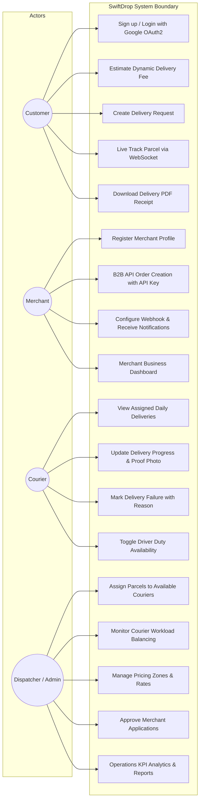
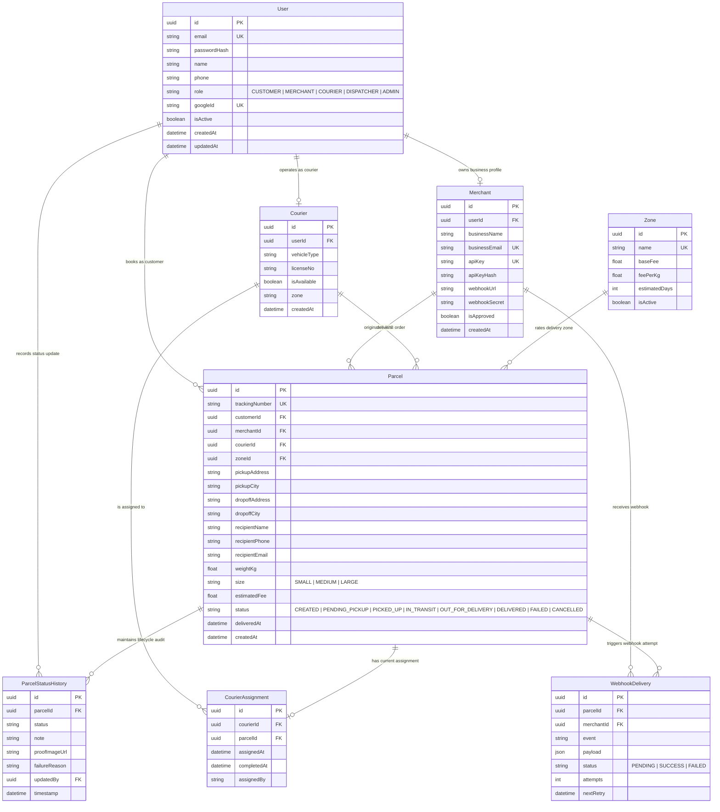
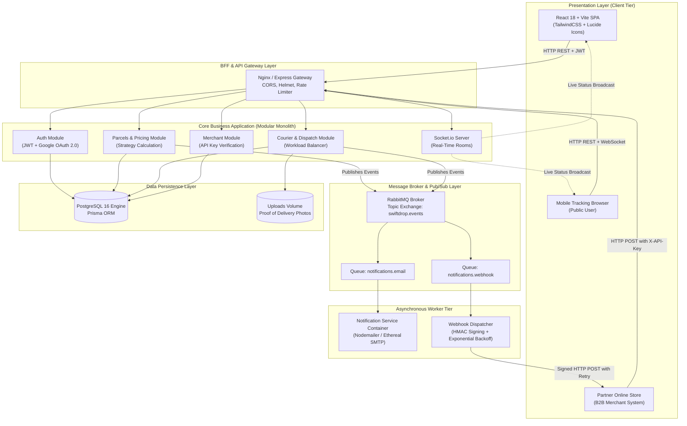
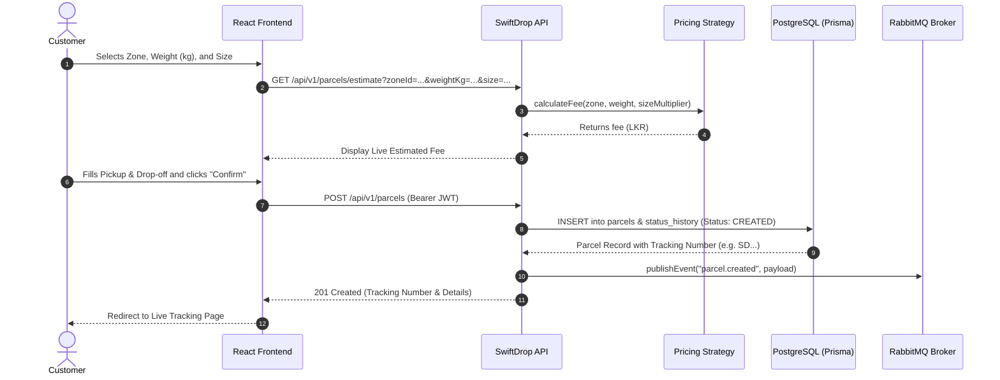
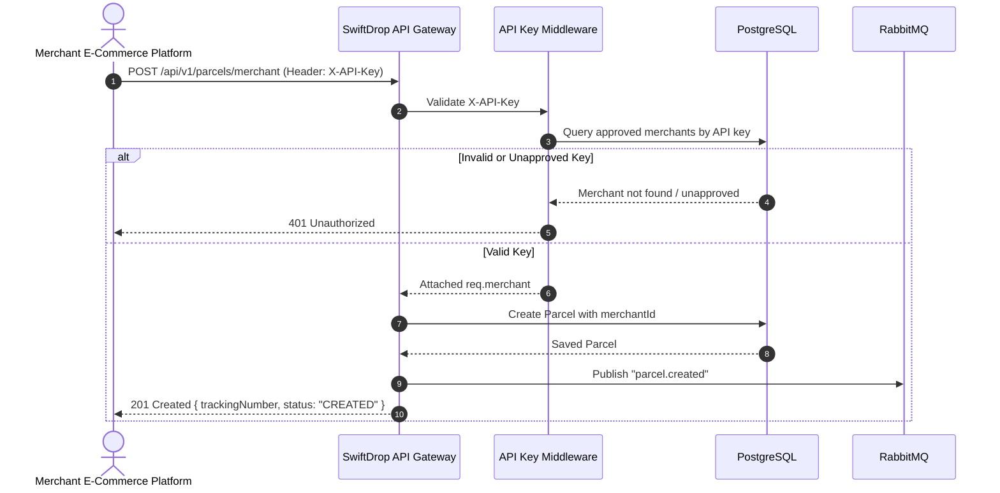
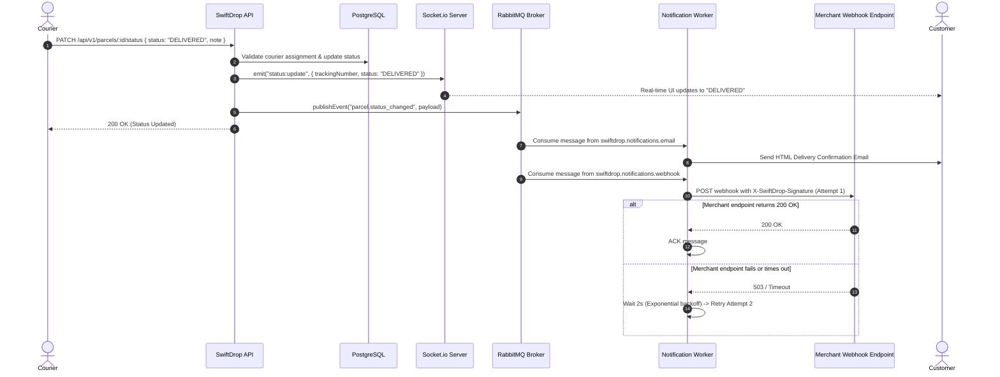
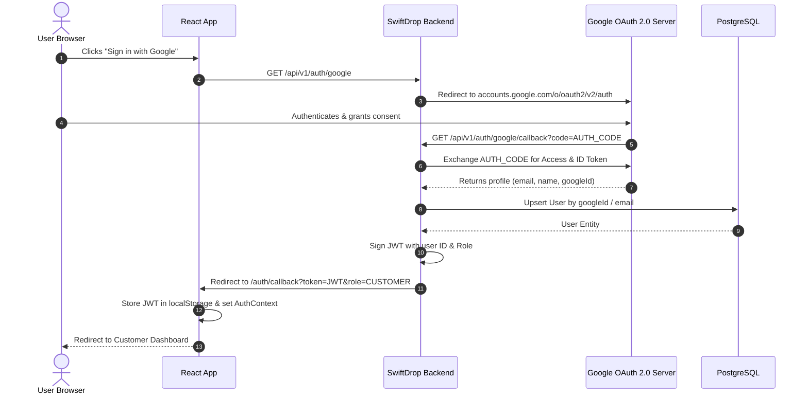

# SwiftDrop — Parcel Delivery & Courier Management System
## Comprehensive System Design & Architecture Specification
**Weightage:** 20 Marks | **Target Group Size:** 10 Members | **Module:** Enterprise Application Development

---

## Table of Contents
1. [Executive Summary & Scenario](#1-executive-summary--scenario)
2. [Actor & Use Case Analysis](#2-actor--use-case-analysis)
3. [Domain Entity Relationship (ER) Model](#3-domain-entity-relationship-er-model)
4. [Architecture Design & Justification (Modular Monolith with BFF)](#4-architecture-design--justification)
5. [Enterprise Integration Architecture](#5-enterprise-integration-architecture)
6. [Key Workflow Sequence & Activity Diagrams](#6-key-workflow-sequence--activity-diagrams)
   - 6.1 Customer Parcel Creation & Pricing Calculation
   - 6.2 Merchant B2B API Order Creation
   - 6.3 Courier Status Update, Event Publishing & Webhook Retries
   - 6.4 Google OAuth 2.0 Social Authentication Flow
7. [Design Patterns & Enterprise Principles Applied](#7-design-patterns--enterprise-principles-applied)
8. [Security & Data Protection Architecture](#8-security--data-protection-architecture)
9. [Verification, Testing & Test Coverage Summary](#9-verification-testing--test-coverage-summary)
10. [Team Responsibilities & Contribution Matrix](#10-team-responsibilities--contribution-matrix)

---

## 1. Executive Summary & Scenario

SwiftDrop operates island-wide courier logistics. Historically reliant on manual phone inquiries and fragmented spreadsheets, the business suffered from:
- Zero customer visibility into package delivery stages.
- No automated pipeline for partner e-commerce merchants to submit bulk orders.
- Dispatch bottleneck and inability to track courier workloads.
- Lack of audit trails for proof of delivery.

The modern SwiftDrop Enterprise Platform eliminates these bottlenecks through an event-driven, containerized architecture that integrates customers, couriers, dispatchers, and merchants into a single unified real-time system.

---

## 2. Actor & Use Case Analysis

The platform serves four primary enterprise actors:

### 2.1 Use Case Diagram (System-Wide)

---

## 3. Domain Entity Relationship (ER) Model

The relational data model is built in PostgreSQL and mapped using Prisma ORM. It enforces relational integrity, audit trails, and strict foreign-key constraints.

---

## 4. Architecture Design & Justification

### 4.1 Architectural Pattern: Modular Monolith with Backend-for-Frontend (BFF)

We selected a **Modular Monolith backed by a BFF Layer and Asynchronous Background Worker Services**:

### 4.2 Architecture Justification
1. **Manageability for 10-Member Team:** Full microservices introduce severe overhead (service discovery, distributed transactions, network latency, multiple pipelines). A Modular Monolith keeps domain boundaries clean within separate folders (`modules/auth`, `modules/parcels`, `modules/couriers`, `modules/merchants`), while running in a shared runtime.
2. **True Event-Driven Decoupling:** Long-running external tasks (sending customer emails, executing HTTP webhooks with retries) are offloaded to a dedicated **Notification Consumer container** over RabbitMQ. The main API responds in milliseconds without blocking on third-party networks.
3. **BFF (Backend-For-Frontend) Adaptability:** Aggregates delivery timelines, courier workloads, and live tracking channels specifically formatted for the React UI.

---

## 5. Enterprise Integration Architecture

### 5.1 Integration Patterns Matrix

| Integration Flow | Pattern Used | Technology | Justification |
|---|---|---|---|
| **Client UI ↔ Backend API** | Request-Reply (Synchronous) | REST over HTTPS / JSON | Immediate feedback required for forms, logins, fee calculation. |
| **Status Update ↔ Notification Consumer** | Publish-Subscribe (Asynchronous) | RabbitMQ Topic Exchange (`swiftdrop.events`) | Prevents transaction rollback if email provider fails; durable queue prevents loss during service restarts. |
| **Backend ↔ Live Tracking Screen** | Observer / Push (Bidirectional) | WebSockets via Socket.io | Push updates instantly without polling overhead or stale cache issues. |
| **Backend ↔ Partner Merchant Platform** | Webhook with Exponential Backoff | HTTP POST with HMAC SHA-256 signature | Enterprise standard for B2B notification; exponential retry handles merchant downtime safely. |
| **Social Login ↔ Identity Provider** | Delegated Authorization | OAuth 2.0 (Google Identity) | Safe social signup without handling third-party passwords. |

---

## 6. Key Workflow Sequence & Activity Diagrams

### 6.1 Customer Parcel Creation & Pricing Calculation

### 6.2 Merchant B2B API Order Creation Flow

### 6.3 Courier Status Update, Event Publishing & Webhook Retries

### 6.4 Google OAuth 2.0 Social Authentication Flow

---

## 7. Design Patterns & Enterprise Principles Applied

| Pattern / Principle | Implementation Location | Engineering Purpose |
|---|---|---|
| **Strategy Pattern** | `parcel.service.js` (`calculateFee`) | Decouples pricing formulas. Zone base rates, per-kg costs, and size multipliers are interchangeable without modifying booking workflows. |
| **Observer Pattern** | RabbitMQ Pub/Sub & Socket.io | Decouples parcel status mutations from email delivery, merchant webhooks, and UI client notifications. |
| **Repository Pattern** | Prisma ORM Models & Service Wrappers | Centralizes data access, query optimization, and schema mapping. |
| **Chain of Responsibility** | Express Middleware Pipeline | Modular security checks: `authenticate` → `authorize(roles)` → `validate(body)` → `controller`. |
| **BFF (Backend for Frontend)** | Express API Endpoints | Serves customer, courier, merchant, and dispatcher needs from dedicated, tailored data contracts. |
| **SOLID Principles** | Modular System Design | - **Single Responsibility:** Auth, Parcels, Couriers, and Webhooks reside in distinct modules. - **Open/Closed:** New status types or delivery zones can be added without modifying core controllers. - **Dependency Inversion:** Config and message publishers are injected into services. |
| **DRY Principle** | Shared Error Handlers & DTO Validators | Centralized `AppError`, `validate` middleware, and formatters eliminate duplicated validation logic. |

---

## 8. Security & Data Protection Architecture

1. **Password Security:** Salted hashing with `bcryptjs` (Cost factor = 12). Plaintext passwords never touch logs or databases.
2. **Stateless JWTs:** Signed using HMAC-SHA256 with 7-day expiration. Includes user role for zero-database authorization checks.
3. **No PII in Logs:** Winston logger is configured to strip sensitive credentials and authorization headers.
4. **B2B API Authentication:** Merchants authenticate via cryptographic 32-byte API keys (`sk_...`) hashed before database storage.
5. **Webhook Security:** Every outgoing webhook payload is signed with HMAC-SHA256 (`X-SwiftDrop-Signature`), allowing merchants to cryptographically verify payload integrity.
6. **Network & HTTP Hardening:** Helmet.js security headers, CORS origin whitelisting, and strict rate-limiting on sensitive endpoints (`/auth/*`).

---

## 9. Verification, Testing & Test Coverage Summary

### Test Automation Suite (Jest + Supertest)
The test suite is structured into three dedicated integration suites located in `backend/__tests__`:
1. `auth.test.js`: Validates registration, bcrypt hashing, rejection of duplicate emails, JWT token generation, and rejection of invalid passwords.
2. `authorization.test.js`: Proves that a courier **cannot** view or update another courier's parcel (HTTP 403 Forbidden), verifying that couriers can only manage their own deliveries.
3. `integration.test.js`: Tests the complete end-to-end pricing strategy calculation, parcel creation, event publishing to RabbitMQ, public tracking retrieval, and status changes.

---

## 10. Team Responsibilities & Contribution Matrix (10-Member Group)

| Member Name | Student ID | Assigned Module / Component | Detailed Contributions |
|---|---|---|---|
| **Member 1 (Lead)** | IT22000001 | Architecture & Core Gateway | Modular Monolith architecture, Express setup, Docker orchestration, environment configuration. |
| **Member 2** | IT22000002 | Authentication & OAuth 2.0 | JWT generation/verification, Passport.js Google OAuth 2.0 strategy, user registration. |
| **Member 3** | IT22000003 | Authorization & RBAC | Role guards (Customer, Merchant, Courier, Dispatcher), resource ownership checks. |
| **Member 4** | IT22000004 | Parcels & Pricing Engine | Parcel booking logic, Strategy pattern dynamic fee calculation, receipt PDF generation. |
| **Member 5** | IT22000005 | RabbitMQ & Pub/Sub Pipeline | RabbitMQ topic exchange declaration, event publishers, consumer channels. |
| **Member 6** | IT22000006 | Notification Service & Worker | Background consumer container, Nodemailer HTML templates, Ethereal mock SMTP integration. |
| **Member 7** | IT22000007 | Merchant B2B API & Webhooks | API Key generation and hashing, webhook dispatching with exponential backoff retry. |
| **Member 8** | IT22000008 | Courier Portal & Uploads | Courier daily console, status transition validation, proof of delivery photo uploads. |
| **Member 9** | IT22000009 | Dispatcher & Operations Admin | Courier assignment engine, fleet workload balancing monitor, KPI analytics reports. |
| **Member 10** | IT22000010 | Frontend SPA & WebSockets | React UI development, Socket.io real-time tracking rooms, TailwindCSS styling. |
