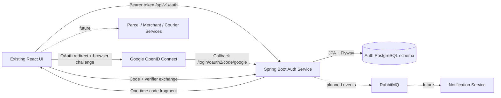

# Initial authentication slice

Auth uses controller → service → repository, safe DTOs and Flyway migrations.
The database is isolated from the old Prisma tables and volumes.
JWTs expire after 15 minutes. Every protected request reloads the current
identity and role from Auth's database, so deactivation and role changes take
effect immediately. Spring Security's resource-server bearer filter verifies
HS256 signatures, issuer, audience and timestamps before authorizing requests.

Browser access tokens live only in memory. A host-only HttpOnly SameSite=Lax
refresh cookie restores the session after reload. Tokens rotate under a family row
lock; only SHA-256 hashes are stored in auth.refresh_tokens. Session families have
an absolute seven-day expiry in auth.refresh_sessions. Replay revokes the family;
logout also revokes it. Browser JWT sid claims are checked against the active family
on every protected request. Old bare API JWTs without sid keep expiry-only behavior.
Cookie mutations require a custom CSRF header and exact allowed Origin. Credentialed
CORS allows only the configured frontend. Production requires COOKIE_SECURE=true
and HTTPS with frontend/API on the same site. Refresh/logout do not use the short
Spring Session OAuth cookie. Hourly cleanup deletes expired families and their tokens.
React coalesces refresh requests, serializes cookie mutations (Web Locks across tabs),
verifies identity using /me, retries API authentication once and broadcasts login/logout.

Google uses Spring Security OIDC (state, nonce, ID token verification), with a
five-minute JDBC session only for the redirect handshake. The 60-second exchange
code is randomly generated, hashed at rest, bound to a SHA-256 browser verifier,
and consumed under a database row lock. No reusable token appears in a URL.
Only verified Google emails are accepted. A returning linked Google subject can
sign in. New identities become CUSTOMER. A password account with the same email
is rejected rather than silently linked; sign in with its password. Explicit
authenticated account linking is a later feature.

The initial UI keeps original business components on disk while routing their
screens to an explicit unavailable state. No business API requests or Socket.io
connections are made by the milestone UI.
