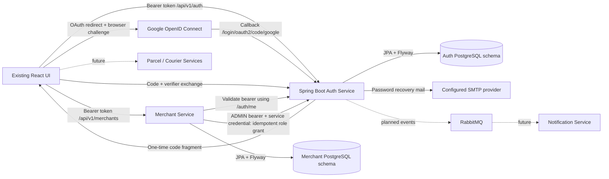

# Authentication and merchant onboarding

Auth uses controller → service → repository, safe DTOs and Flyway migrations.
The database is isolated from the old Prisma tables and volumes.
JWTs expire after 15 minutes. Every protected request reloads the current
identity and role from Auth's database, so deactivation and role changes take
effect immediately. Spring Security's resource-server bearer filter verifies
HS256 signatures, issuer, audience and timestamps before authorizing requests.

Browser access tokens live only in memory. A host-only HttpOnly SameSite=Lax
refresh cookie restores the session after reload. Tokens rotate under a family row
lock; only SHA-256 hashes are stored in auth.refresh_tokens. Session families have
an absolute seven-day expiry in auth.refresh_sessions. Replay revokes the family;
logout also revokes it. Browser JWT sid claims are checked against the active family
on every protected request. Bare API JWTs without sid cannot be individually logged out; identity changes
invalidate them through the authentication version.
Cookie mutations require a custom CSRF header and exact allowed Origin. Credentialed
CORS allows only the configured frontend. Production requires COOKIE_SECURE=true
and HTTPS with frontend/API on the same site. Refresh/logout do not use the short
Spring Session OAuth cookie. Hourly cleanup deletes expired families and their tokens.
React coalesces refresh requests, serializes cookie mutations (Web Locks across tabs),
verifies identity using /me, retries API authentication once and broadcasts login/logout.

Google uses Spring Security OIDC (state, nonce, ID token verification), with a
five-minute JDBC session only for the redirect handshake. The 60-second exchange
code is randomly generated, hashed at rest, bound to a SHA-256 browser verifier,
and consumed under a database row lock. No reusable token appears in a URL.
Only verified Google emails are accepted. Stable Google subjects resolve existing
identities. A new subject automatically connects to a matching active password-enabled
account after its current activation requirements are satisfied, preserving identity,
credentials and role. Credential-free pending accounts must activate first; the
application has no separate local email-verification flag. If no match exists, Google
signup creates CUSTOMER. Conflicting associations fail closed and are audited in a
separate transaction so security events survive rejection. A shared database guard
serializes first-login creation/linking, with unique email/subject constraints as the
final protection. Adding a credential revokes older sessions and codes through the
existing authentication version before the usual OAuth exchange issues a new session.
Manual linking, its password reauthentication and its endpoint are removed. Existing
provider records and applied migrations remain intact. See the README for activation,
bootstrap and ADMIN identity management.

Password recovery returns a generic response before asynchronous eligibility/mail
work. Shared database rate limits bound email/IP requests. Random reset tokens have
a 20-minute lifetime and only SHA-256 hashes are stored. Reset locks the identity,
consumes all outstanding reset tokens, changes BCrypt credentials and revokes every
session through the existing authentication version. SMTP failures remove the
undelivered token and never disclose account existence to the caller.

Merchant applications move PENDING -> APPROVING -> APPROVED, or PENDING -> REJECTED.
Rejected applicants may edit and explicitly resubmit. Ownership comes from Auth's
verified identity; DTOs cannot assign user IDs, roles or statuses. Row locks and
versions serialize conflicting reviews. Merchant commits APPROVING before calling
Auth; Auth's application-ID grant is idempotent. Failed synchronization stays
APPROVING and ADMIN can retry with fresh authorization. No bearer is persisted for
background retries. Only successful role synchronization permits APPROVED. Business
access requires both MERCHANT role and an approved owned profile. A pre-provisioned
MERCHANT receives no automatic business approval. Each service owns its schema;
there is no distributed database transaction or direct cross-schema query.

Merchant's Auth client accepts HTTP only on loopback for local development and
requires HTTPS elsewhere. Production must supply matching private service keys,
SMTP configuration and separate schema-scoped database identities. Existing Compose
and Kubernetes deployment wiring is unchanged. Parcel, orders, API keys, RabbitMQ
events, webhooks and tracking remain future work; original dashboard components
remain on disk and unavailable operations retain Coming Soon states.
